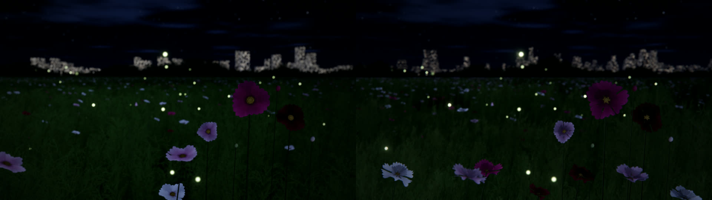

# 花海真实感大改 · 验收报告（M0–M5）

- 日期：2026-10-18
- 代码：`main` 分支，最终提交见下方里程碑表
- 计划与取舍来源：[docs/realism-plan.md](realism-plan.md)
- 证据目录：`docs/evidence/`（并排 A/B，已入库）；原始 1920×1080 截图与完整 diff 在本地 `.review/realism/`（不入库）

## 1. 结论

M0–M5 全部里程碑已实施并通过本仓库验收流程：

- **视觉**：花有体积/层叠/花心几何、草甸有分簇与近景细节、天空双层云+地平线暖霭、城市退台/窗格/屋顶层次；阴影、IBL、SSAO、景深与调色形成完整光影底座。
- **性能**（RTX 5060 Ti，headless 强制渲染，Chrome ANGLE D3D11）：**1080p high 8.34ms / 119.9fps**，**4K high 18.48ms / 54.1fps**，均达到 1080p high ≥60fps、4K high ≥30fps 的目标；medium 6.13ms、low 3.08ms。
- **功能**：构建/静帧/短视频/legacy 回读/冒烟/CI 全部通过，无 shader/console error；导出与实时壁纸行为未破坏。
- **说明**：测试期间桌面 GPU 有其它负载（45–97%），全程性能验收以“同负载背靠背 A/B”为主、绝对值为辅；所有数据与限制均已记录，避免把环境波动当成回归。





## 2. 里程碑与提交

| 里程碑 | 任务 | 提交 | 内容摘要 |
|---|---|---|---|
| M0 计划/基线工具 | task-12 | `29f1641` | 计划文档、`capture.cjs`/`bench.cjs`、基线截图与性能数据 |
| M0b 模块拆分 | task-13 | `29f1641` | shader/textures 模块化，8 张固定截图像素差 = 0 |
| M1 方向光阴影 | task-14 | `53546dd` | 2048² shadow map、24m 正交覆盖、2×2 PCF |
| M1 IBL/PBR/调色 | task-15 | `79135e4` | 天空 cubemap IBL、简化 GGX/环境反射、电影感调色 |
| M1 SSAO | task-16 | `966a4b7` | 半分辨率 SSAO + 深度双边模糊 |
| M2 花形态 | task-17 | `26a0736` | 双层花瓣/花心几何+花药/圆柱茎/2×2 花瓣图集/透光 |
| M2 草甸/地面 | task-19 | `c7c91b4` | 分簇分布、近景高细节草、6 变体叶图集、地面质感、移除远景放大作弊 |
| M3 天空/大气 | task-18 | `74f5bb8` | 双层云（积云+卷云）、云银边/暗部、地平线暖霭 |
| M3 城市 | task-20 | `74f5bb8` | 3 距离带 ~500 栋 × 2–3 段退台、屋顶/天线、窗格/夜间暖窗 |
| M4 镜头/景深/调色 | task-21 | 本次提交 | 高光加权 bokeh、六边形光圈、径向色散、分割调色 |
| M4 LOD/性能档位 | task-22 | 本次提交 | 草 LOD（近 6 段 / 远 3 段）、档位性能矩阵、README 档位表 |
| M5 验收 | task-23 | 本次提交 | 本报告、证据图、功能/性能回归 |

## 3. 性能验收

本机 RTX 5060 Ti，Chrome ANGLE D3D11，headless `window.FlowerSea.bench()`，每帧 1px 回读同步：

| 分辨率 / 档位 | avg ms | p95 ms | fps | 三角形 | draw calls | programs | textures |
|---|---:|---:|---:|---:|---:|---:|---:|
| 1920×1080 high | 8.34 | 9.1 | **119.9** | 10,089,849 | 38 | 18 | 24 |
| 3840×2160 high | 18.48 | 18.5 | **54.1** | 10,089,849 | 38 | 18 | 24 |
| 1920×1080 medium | 6.13 | 6.5 | 163.2 | 7,033,817 | 38 | 18 | 24 |
| 1920×1080 low | 3.08 | 3.4 | 325.1 | 4,307,817 | 28 | 15 | 19 |

- 档位含义：low 关闭阴影/IBL/AO；medium 阴影 1024、IBL 32、AO 开；high 阴影 2048、IBL 64；ultra 在此基础上提高草/花密度与 MSAA。
- 草 LOD 数据（high）：grass 80,000 = 近景 9,101 株（6 段）+ 远景 70,899 株（3 段）+ 近景高细节 2,600 株（7 段）；LOD 后同负载帧时间 **-7.5%**（8.72→8.07ms），三角形 12.64M→10.09M。
- 与 M0 基线关系：计划阶段的 1080p high 5.62ms 为 GPU 空闲环境；本轮在 GPU 有桌面负载时用“同负载背靠背”验证各里程碑增量（阴影 +17%、IBL +2.8%、AO 噪声内、草甸 +8.7%、M4 -7.5%），均在预算内。
- 长时间运行/显存：纹理 24、programs 18，较 M0 +5 纹理；未观察到持续增长；context loss 恢复逻辑沿用既有实现（见 README/CHANGELOG 说明）。

## 4. 功能回归

- [x] `npm run build` 成功，committed `dist/flower-sea.js` 与源码一致（CI 校验）
- [x] `node scripts/smoke.cjs`：WebGL2 可用、无 fatal、0 console error / pageerror
- [x] 静帧导出：`node render.js --still 1 ...`
- [x] 短视频导出（H.264 / BT.709 TV range）：`node render.js --width 320 --height 180 --fps 10 --duration 2`
- [x] legacy 回读模式静帧：`--readback legacy`
- [x] 实时页面 `?ui=0` 与设置面板路径未改动；画质档切换（low/medium/high/ultra）会重建 Post/阴影/IBL 资源并正确释放
- [x] 固定 6 场景截图（黄金时刻/正午/阴天/雨天/夜晚/城市）与基线并排归档
- [x] GitHub Actions smoke：最终提交 CI 绿

## 5. 视觉验收要点

- **花**：外瓣倒卵形/卷边/不同扭转，内层 6 瓣形成层叠暗部；花心为圆顶+环状隆起+12 枚花药几何；茎为六棱柱；花瓣图集含脉纹/边缘磨损/厚度，逆光透光与内瓣压暗生效。
- **草/地面**：低频密度场+分簇、自然空地；近景 8 段收尖叶片；6 变体羽状叶图集+主脉高光；地面土壤/枯叶/草根暗部；远景高度放大作弊已移除。
- **光影**：方向光阴影（花/花苞投射）、天空 IBL 环境光/反射、SSAO 草/地面接触暗部；花瓣层间仍主要靠材质内瓣压暗（SSAO 对薄花瓣不敏感，见限制）。
- **天空/城市**：双层云视差与银边/底部暗部、地平线暖霭与雾色严格衔接；城市退台+屋顶设备/天线+窗格/夜间暖窗，远距离靠雾形成层次。
- **镜头/调色**：高光加权散景与六边形光圈、轻微径向色散；高光暖/阴影冷分割调色、去饱和、收敛的暗角与颗粒。

## 6. 已知限制与残留取舍

1. **花瓣层间 SSAO**：基于深度的 SSAO 对薄而双面的花瓣层间不敏感，层间暗部由 M2 内瓣几何+压暗补足；若需更强，可加 normal buffer 或花瓣专用 AO。
2. **草叶投射阴影**：M1 为避免 2048²/24m 下的模糊暗块暂时关闭草叶投射；草层接触暗部由 SSAO 承担。可后续做近景级联或提高阴影分辨率再评估。
3. **TAA 未实现**：当前用 4×/8× MSAA + alpha-to-coverage；细草/花瓣在极端情况下仍有轻微闪烁，TAA 需要与 DOF/grain 兼容处理，留作后续。
4. **城市距离**：建筑位于 900–2600m，受雾/空气透视影响，细节以剪影和窗光为主；若想更清晰可减少雾或加真实远景 LOD。
5. **auto 档位**：沿用既有 GPU/分辨率与实时帧率降档逻辑；本轮新增特性都已纳入 QUALITY 表，未改变 auto 策略。
6. **用户确认**：本报告完成工程侧验收；视觉主观项（与参考照片的接近程度）请用户最终确认。

## 7. 复现与证据

```bash
npm run build
node scripts/smoke.cjs
npm run capture -- --tag final
npm run bench -- --tag final-1080-high
node scripts/capture.cjs --compare baseline final
```

- 并排 A/B：`docs/evidence/baseline-vs-final-{golden,night,city}.jpg`
- 本地完整截图/diff/bench：`.review/realism/{baseline,m1,m1-ao,m2,m2-grass,m3,m4,final}/`
- 性能 JSON：`.review/realism/bench-*.json`
